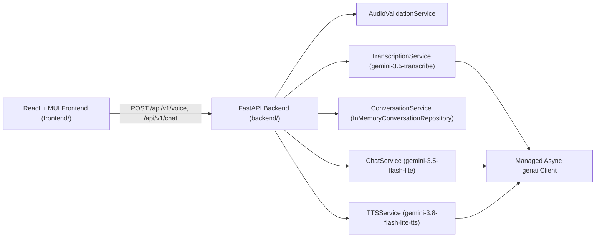

# Multilingual AI Voice Assistant (Monorepo)

A full-stack **monorepo** multilingual AI voice assistant combining a **FastAPI + Google Gen AI SDK (`google-genai`)** backend (`backend/`) and a **React + JavaScript + Material UI (MUI)** frontend (`frontend/`).

Users can record speech directly in the browser, upload audio files, or send text messages in any supported language (such as English, Tamil, Hindi, or code-switched speech) and receive context-aware text and synthesized audio responses.

---

## Monorepo Structure

```text
multilingual-voice-assistant/
├── backend/                  # FastAPI + Gemini API service
│   ├── app/
│   │   ├── api/              # Versioned REST endpoints (/api/v1/voice, /api/v1/chat)
│   │   ├── core/             # Config, Gemini client, exceptions, lifespan
│   │   ├── repositories/     # Conversation history storage
│   │   ├── schemas/          # Pydantic request/response models
│   │   ├── services/         # Audio validation, transcription, chat, conversation, TTS
│   │   └── utils/            # Magic-byte audio parsing, PCM->WAV wrapping, helpers
│   ├── scripts/              # Standalone Gemini connectivity & transcription scripts
│   ├── tests/                # Pytest + HTTPX test suite
│   ├── .env.example
│   └── pyproject.toml
├── frontend/                 # React + JavaScript + MUI web app (Vite)
│   ├── src/
│   │   ├── api/              # Backend REST client
│   │   ├── components/       # HeaderBar, ConversationThread, MessageBubble, AudioInputBar
│   │   ├── utils/            # MediaRecorder & base64 audio Blob helpers
│   │   ├── App.jsx
│   │   ├── main.jsx
│   │   └── theme.js
│   ├── .env.example
│   ├── index.html
│   ├── package.json
│   └── vite.config.js
├── .env.example
├── .gitignore
└── README.md
```

---

## Architecture



---

## Technology Stack

### Backend (`backend/`)
- **Python 3.12+** & **`uv`**
- **FastAPI** + **Pydantic** / **Pydantic Settings**
- **Google Gen AI SDK (`google-genai`)**:
  - Transcription: `gemini-3.5-transcribe`
  - Chat LLM: `gemini-3.5-flash-lite`
  - Text-to-Speech: `gemini-3.8-flash-lite-tts`
- **Testing & Linting**: `pytest`, `httpx`, `ruff`

### Frontend (`frontend/`)
- **React 18** (JavaScript) + **Vite**
- **Material UI (`@mui/material`, `@mui/icons-material`)**
- Browser **MediaRecorder API** for microphone capture & HTML5 `<audio>` playback

---

## Prerequisites

- **Python 3.12+** and **`uv`**
- **Node.js 20+** and **`npm`**
- **Google AI Studio API key** (`GEMINI_API_KEY`)
- **Optional**: `ffmpeg` / `ffprobe` on `PATH` for duration inspection of MP3, M4A, AAC, and WebM files (WAV, FLAC, and OGG/Opus durations are inspected in pure Python).

---

## Environment Configuration

Configure `.env` at the repository root (or inside `backend/.env`):

```bash
cp .env.example .env
```

```env
GEMINI_API_KEY=your_google_ai_studio_api_key

TRANSCRIPTION_MODEL=gemini-3.5-transcribe
CHAT_MODEL=gemini-3.5-flash-lite
TTS_MODEL=gemini-3.8-flash-lite-tts
TTS_VOICE=Kore

MAX_AUDIO_SIZE_MB=20
MAX_AUDIO_DURATION_SECONDS=300
```

Optionally configure `frontend/.env` from `frontend/.env.example` (`VITE_API_BASE_URL` can stay empty during development because `frontend/vite.config.js` proxies `/api` and `/health` to `http://127.0.0.1:8000`).

---

## Setup & Running Locally

### 1. Start the Backend (`http://127.0.0.1:8000`)

```bash
cd backend
uv sync
uv run uvicorn app.main:app --reload
```

API docs are available at `http://127.0.0.1:8000/docs`.

### 2. Start the Frontend (`http://localhost:5173`)

In a second terminal:

```bash
cd frontend
npm install
npm run dev
```

Open `http://localhost:5173` in your browser.

---

## API Endpoints

- `GET /health` — Backend readiness & Gemini client status (no secrets exposed)
- `POST /api/v1/voice` (`multipart/form-data`: `audio`, optional UUID `conversation_id`) — Validates audio, transcribes, detects language, replies in context, and returns synthesized TTS WAV audio
- `POST /api/v1/chat` (`application/json`: `message`, optional UUID `conversation_id`, `generate_audio`) — Text chat turn with optional TTS audio

---

## Testing & Verification

### Backend Tests & Linting

```bash
cd backend
uv run ruff check .
uv run pytest -v

# Opt-in live Gemini API integration test
uv run pytest -m integration -v
```

### Frontend Production Build

```bash
cd frontend
npm run build
```

---

## Known Limitations

- **In-memory conversation storage**: Conversations are stored in process memory (`InMemoryConversationRepository`), are lost on server restart, and are not shared across multiple worker processes.
- **Language metadata extraction**: `gemini-3.5-transcribe` detects spoken languages internally but returns only `output_text`; `TranscriptionService` performs a follow-up structured output call on `CHAT_MODEL` to extract `language_code` and `language_name`.
- **Browser recording formats**: Depending on browser support, `MediaRecorder` emits `audio/webm`, `audio/ogg`, or `audio/mp4`; without `ffprobe`, duration checks on WebM/MP3/M4A/AAC are skipped unless `REQUIRE_AUDIO_DURATION_CHECK=true`.
